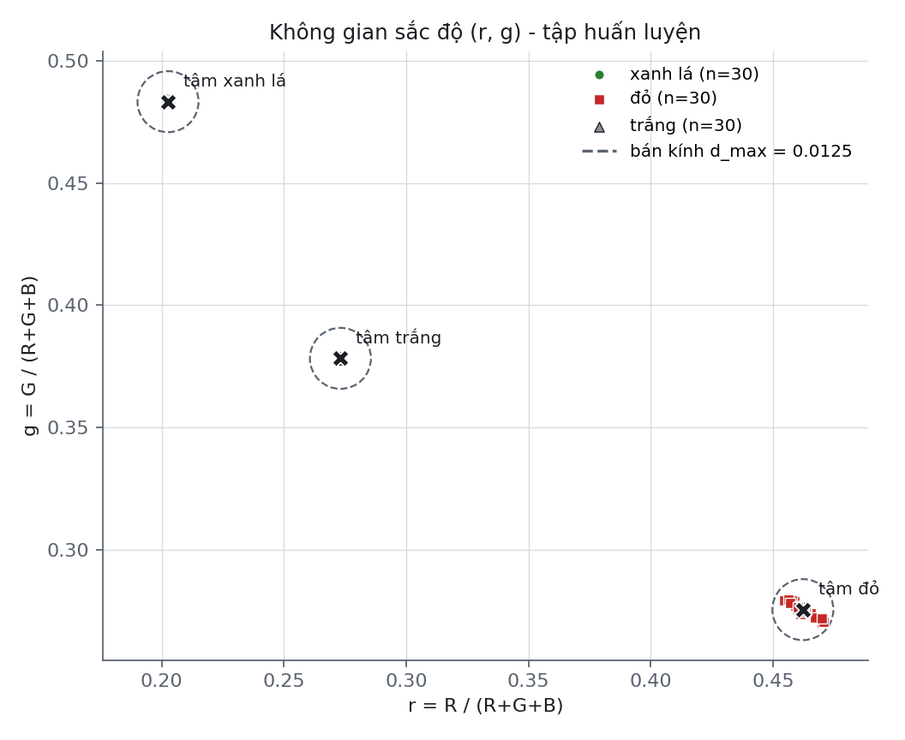
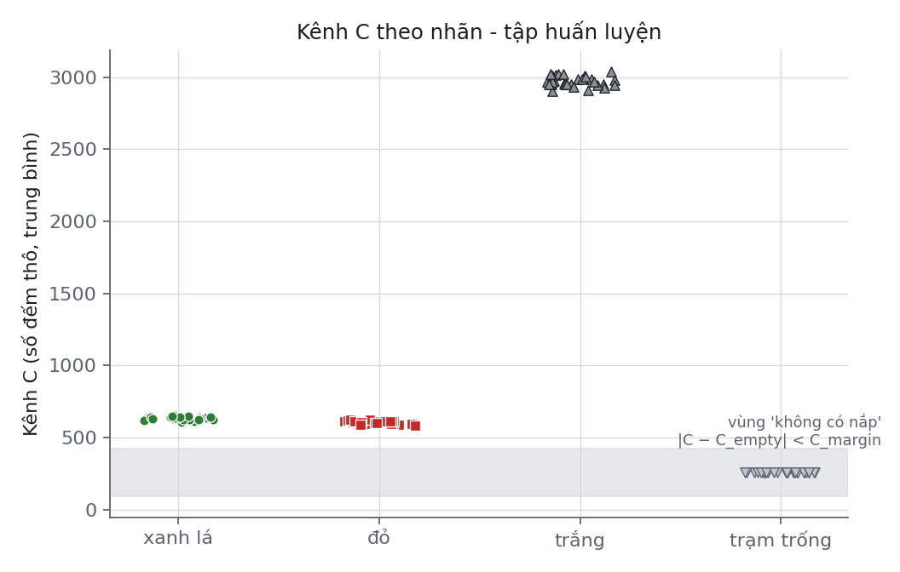
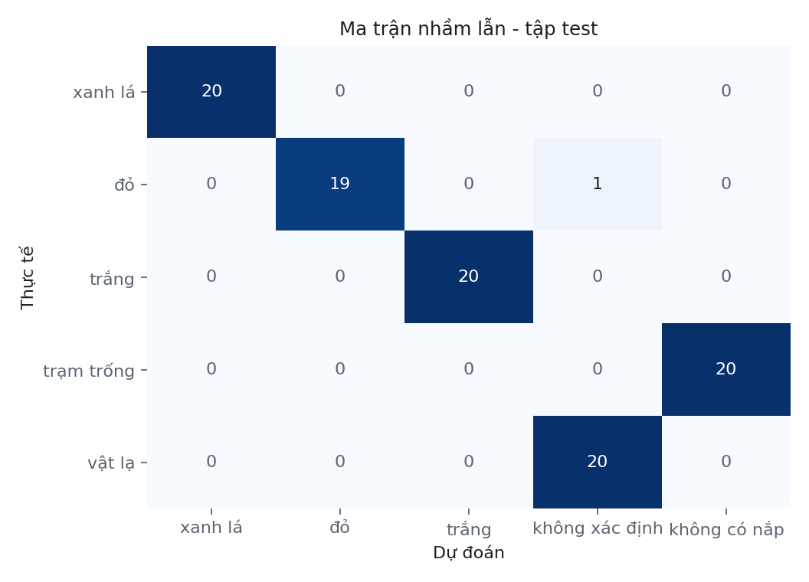

# Báo cáo hiệu chuẩn phân loại màu nắp chai (GY-33)

Tạo lúc 2026-10-23T14:59:53 bởi `tools/colorcal/colorcal.py`.

## 1. Mô hình (tập huấn luyện)

Cấu hình đo: LED mức 3, navg=5, chờ 300 ms (≈ 0.78 s/phép đo)

| Lớp | n | r̄ | ḡ | d̄ | σ_d | d lớn nhất |
|---|---|---|---|---|---|---|
| xanh lá | 30 | 0.2026 | 0.4833 | 0.0007 | 0.0003 | 0.0015 |
| đỏ | 30 | 0.4622 | 0.2755 | 0.0037 | 0.0029 | 0.0098 |
| trắng | 30 | 0.2731 | 0.3783 | 0.0002 | 0.0001 | 0.0005 |

- d_max = max_k(d̄_k + 3·σ_d,k) = **0.0125**; d_max / (D_min/2) = 0.20 (không chồng lấn)
- Kênh C: C_empty = 258.0, trạm trống dao động ±1.0, nắp gần nhất cách 326.0 → C_margin = 163.5
- Leave-one-out: đúng 120/120 (100.0%), sai màu 0.

## 2. Đánh giá trên tập kiểm tra độc lập

| Thực tế \ Dự đoán | xanh lá | đỏ | trắng | không xác định | không có nắp |
|---|---|---|---|---|---|
| xanh lá | 20 | 0 | 0 | 0 | 0 |
| đỏ | 0 | 19 | 0 | 1 | 0 |
| trắng | 0 | 0 | 20 | 0 | 0 |
| trạm trống | 0 | 0 | 0 | 0 | 20 |
| vật lạ | 0 | 0 | 0 | 20 | 0 |

- Đúng **99/100 = 99.0%** (KTC 95% Wilson: 94.6% – 99.8%); nắp bị phân **sai màu**: 0
- ESP32 và Python cho cùng nhãn ở 100/100 mẫu.

## 3. Đoạn mô tả gợi ý cho báo cáo

Cảm biến GY-33 hoạt động ở chế độ MCU_IIC; ESP32 đọc các giá trị RGBC thô 16 bit (thanh ghi 0x00–0x07) với LED của module ở mức 3. Mỗi phép đo chờ 300 ms sau khi nắp được đặt, rồi lấy trung bình 5 lần đọc cách nhau 120 ms. Giá trị R, G, B được chuẩn hóa thành tọa độ sắc độ r = R/(R+G+B), g = G/(R+G+B). Tâm của ba lớp được tính từ 30, 30 và 30 mẫu huấn luyện (xanh lá, đỏ, trắng); nắp được gán vào lớp có tâm gần nhất theo khoảng cách Euclid. Ngưỡng loại bỏ d_max = 0.0125 được xác định bằng max_k(d̄_k + 3σ_k); nắp có khoảng cách lớn hơn d_max được đưa vào khu vực vứt bỏ và báo lỗi qua Serial. Trạm được xem là không có nắp khi |C − 258| < 163. Trên tập kiểm tra độc lập gồm 100 mẫu, hệ thống phân loại đúng 99 mẫu (99.0%, khoảng tin cậy 95% Wilson 94.6% – 99.8%), với 0 trường hợp nắp bị phân sai màu.
